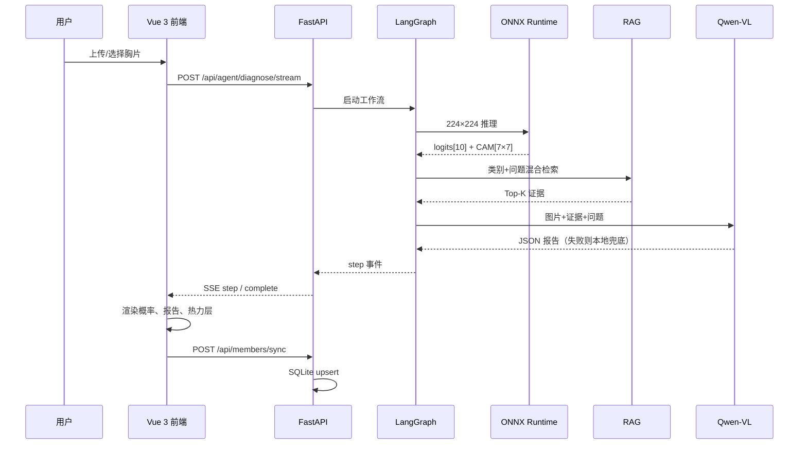

# ChestX-AI 完整优化方案（传智杯 AI Web 赛道）

> 版本：1.0  
> 日期：2026-10-19  
> 适用范围：`ChestX-AI-演示运行包` 当前版本  
> 目标：在参赛截止前，把项目从“能演示的原型”升级为“框架合规、交互可靠、材料完整”的参赛作品。

---

## 0. 一页结论

### 0.1 当前判断

- **选题与技术栈匹配度高**：健康科普 + 多模态 + RAG + Agent + 可解释性，正好覆盖 AI Web 赛道的核心能力。
- **当前不能直接提交**：运行的前端不是 Vue，而是 4806 行原生 DOM 单文件；Vue `src/` 是未接线、未构建的半成品。
- **存在演示真实性问题**：默认病例首次点击“开始 AI 智能分析”会走假进度条并展示硬编码结果，不调用模型。
- **存在提交合规问题**：无 Git 历史、无 README、无技术文档、`.env` 内含可用 API Key。
- **存在查看器正确性问题**：卷帘对比对真实后端热力图失效；非正方形图片热力图错位；高频交互重复解码。

### 0.2 三条主线

1. **让 Vue 真正运行**：主链路 Vue 化、Vite 构建、单端口托管。
2. **让查看器正确且流畅**：热力层缓存、DPR、宽高比、卷帘裁剪、缩放锚点、平移边界、触控。
3. **让作品可提交**：密钥轮换、Git 历史、README、模型卡、技术文档、演示视频、离线兜底。

### 0.3 时间盒

按 14 个自然日规划（2026-10-19 → 2026-11-01）。若校内截止更早，按第 10 节裁剪：

- 必须完成：Phase 0、Phase 1、Phase 2、Phase 5。
- 可压缩：Phase 3 的模型指标、Phase 4 的完整离线包。
- 绝不可省：密钥轮换、Vue 真运行、假分析路径修复、README/视频/文档。

---

## 1. 现状基线（已实测）

### 1.1 真实运行链路

```text
start.bat
  ├─ 创建/复用 .venv，安装 backend/requirements.txt
  ├─ uvicorn backend.main:app            :8000
  └─ python -m http.server               :8765
       └─ 打开 frontend/index.html?api=http://127.0.0.1:8000
            ├─ 内联 <script>（约 1609-4804 行）
            ├─ 全局 AppState
            └─ fetch /api/agent/diagnose/stream、/api/agent/chat/stream
```

**关键事实**：`frontend/src/` 不参与运行；没有 `dist/`；没有 `node_modules/`；`start.bat` 不执行 `npm`/`vite`。

### 1.2 已核实问题

| ID | 严重度 | 问题 | 证据 |
|---|---|---|---|
| P0-01 | 阻断 | Vue 未运行，演示走原生 DOM | `start.bat:149,165`；`index.html` 无 `#app`、无 `src/main.js` |
| P0-02 | 阻断 | 默认病例存在假分析路径 | `index.html:2103,3426,3458-3483`；首次点击不请求后端 |
| P0-03 | 阻断 | 真实 API Key 随包分发 | `backend/.env`；实测 DashScope HTTP 200 |
| P0-04 | 阻断 | 无 Git、无 README、无技术文档、无视频 | 项目根目录实测 |
| P0-05 | 高 | 依赖 Tailwind/ECharts CDN，弱网掉样式 | `index.html:7,9` |
| P1-01 | 高 | 卷帘对比对后端热力图无效 | `index.html:2525-2533` 提前 `return`，绕过 `2541-2547` |
| P1-02 | 高 | 非正方形图片热力图错位 | 底板 `object-contain`，画布固定 420×420（`830-846`） |
| P1-03 | 高 | 高频交互重复解码热力图 | 每次 `syncViewerTransform()` 都 `new Image()`（`2525-2533`、`4522-4527`） |
| P1-04 | 高 | 无 rAF 合帧、无 DPR | `mousemove` 直接重绘；`canvas width=420` |
| P1-05 | 高 | 缩放不是鼠标锚点，平移无边界 | `index.html:4505-4513,4522-4527` |
| P1-06 | 高 | 触摸端无捏合/拖动 | 仅 mouse 事件，无 pointer/touch |
| P1-07 | 高 | 问答“流式”是伪流式 | `qwen_client.py:176-182`；`chat_service.py:210-217` 先等完整结果 |
| P1-08 | 高 | 样本 1 与样本 2 实际同图 | `main.py:33-36` 都映射 `sample_2.jpg` |
| P1-09 | 高 | 类别词表不一致（10 类 vs 硬编码 14 类） | `config.py:21-32`；`index.html:1851-1921` |
| P1-10 | 中高 | “Grad-CAM”未经梯度计算，需核实 | `model_infer.py:70-72` 仅使用 ONNX 第二输出 |
| P2-01 | 中 | CORS 为 `*` 且接口无鉴权 | `config.py:19` |
| P2-02 | 中 | 成员同步全量删除重建，存在数据覆盖风险 | `database.py:126-202` |
| P2-03 | 中 | 可访问性不足 | Canvas 无 `role/aria-label`；range 无 `aria-label`；无键盘平移 |
| P2-04 | 中 | ECharts 实例未 dispose | `index.html:3345,4237,4309` |
| P2-05 | 中 | 重复 store / 未使用依赖 | `store/chestxStore.js` 与 `stores/useUserStore.js` 重复 |

### 1.3 现有优势

- 后端分层清晰：路由、工作流、推理、检索、报告、持久化职责明确。
- 每层有降级：Qwen 不可用 → 本地报告；检索无证据 → 本地兜底；LangGraph 缺失 → 轻量图执行器。
- 医疗安全护栏完整：免责声明、禁用词、证据引用、低置信度提示。
- SSE 事件契约清晰：`step` / `token` / `complete` / `error`。
- ONNX 模型可在 CPU 运行，包体约 33 MB，满足 ≤200 MB。
- 知识库有来源链接，教学图片有授权说明（`frontend/assets/knowledge/SOURCES.md`）。

### 1.4 实测数据

- ONNX 输入：`['batch', 3, 224, 224]`；输出：`logits ['batch', 10]`、`feature_map ['batch', 7, 7]`。
- `sample_1.jpg`：Atelectasis 56.6%，Infiltration 54.0%。
- `sample_2.jpg`：Infiltration 80.3%，Nodule 79.6%。
- `sample_3.jpg`（标注正常）：No Finding 76.9%，但 Infiltration 65.4%。
- 1024² 热力图 JPEG 约 103 KB，base64 约 138 K 字符；后端同时返回两份相同字段。
- DashScope `qwen3.8-flash` 连通性测试：HTTP 200。

> 结论：模型能跑，但概率未校准；“正常”样本仍出现较高的次要概率，演示话术需要谨慎。

---

## 2. 目标与非目标

### 2.1 目标

| 目标 | 验收口径 |
|---|---|
| 框架合规 | 浏览器运行的必须是 Vue 3 应用；Network 加载 `assets/index-*.js`；Vue Devtools 可见组件树 |
| 主链路可用 | 上传/样本 → SSE 步骤 → 概率/报告/热力图 → 保存档案，全流程无硬编码结果 |
| 查看器正确 | 卷帘、缩放、平移、热力图在任意宽高比和 DPR 下对齐正确 |
| 交互流畅 | 2048×2048 图片拖拽无可感知卡顿；拖拽期间每病例只解码一次热力图 |
| 提交合规 | Git 增量历史、README、环境说明、模型卡、≤30 页技术文档、5-8 分钟视频、≤200 MB 包 |
| 演示稳健 | 断网/额度耗尽/模型缺失时均有明确降级，不出现假结果 |

### 2.2 非目标

- 不做临床级精度承诺。
- 不重写后端架构。
- 不把平移缩放改成 Canvas 像素级重绘（CSS transform 是正确选择）。
- 不伪造 Git 提交历史或模型指标。
- 不在本轮实现多用户账号体系/云部署（在线演示为可选项）。

---

## 3. 技术路线决策

### 3.1 前端路线

| 路线 | 描述 | 优点 | 风险 | 结论 |
|---|---|---|---|---|
| A | 全量 Vue 重写 6 个页面 | 最合规 | 工作量大 | 时间充足时选 |
| B+ | Vue 应用壳 + 全部路由；主链路（解读/聊天/档案/设置）真实可用；知识/学堂/关于先静态后增强 | 合规且可控 | 仍需接线 | **推荐** |
| C | 保留原生 DOM，仅保留 Vue 源码供审查 | 最快 | 评委运行即暴露；诚信风险 | 不采用 |

**决策：B+。** 先保证评委一定会操作的路径是真的，再补次要页面。

### 3.2 部署形态

**单端口**：Vite 构建 `frontend/dist`，FastAPI 同时提供 `/api` 和静态资源。`start.bat` 只启动 uvicorn，打开 `http://127.0.0.1:8000/`。

好处：

- 消除 8000/8765 双端口和 CORS。
- 评委只需双击一次。
- 生产环境不依赖 Node.js。
- 便于后续部署到云服务器。

开发时仍用 `vite --port 8765` + `/api` 代理到 8000。

### 3.3 目标目录

```text
ChestX-AI-演示运行包/
├─ backend/
│  ├─ main.py                 # API + 静态资源 + SPA fallback
│  ├─ workflow.py
│  ├─ model_infer.py          # 返回结构化 CAM/尺寸，不再返回双份 base64
│  ├─ chat_service.py         # 真流式
│  ├─ qwen_client.py          # stream=True 上游解析
│  ├─ report_service.py
│  ├─ rag/
│  ├─ data/                   # 运行时生成，禁止提交
│  ├─ tests/                  # 新增
│  └─ requirements.txt
├─ frontend/
│  ├─ index.html              # Vite 入口（仅 #app + main.js）
│  ├─ package.json
│  ├─ vite.config.js
│  ├─ tailwind.config.js      # 新增
│  ├─ postcss.config.js       # 新增
│  ├─ dist/                   # 构建产物，随包提交
│  └─ src/
│     ├─ main.js
│     ├─ App.vue
│     ├─ router/index.js      # 新增
│     ├─ style.css            # Tailwind 指令
│     ├─ api/client.js
│     ├─ stores/useUserStore.js
│     ├─ stores/useDiagnoseStore.js
│     ├─ stores/useViewerStore.js
│     ├─ composables/useXrayViewer.js
│     ├─ renderer/HeatmapLayer.js
│     ├─ components/
│     └─ views/
├─ OPTIMIZATION_PLAN.md
├─ README.md                  # 新增
├─ MODEL_CARD.md              # 新增
├─ .gitignore                 # 新增
├─ .env.example               # 新增
├─ start.bat
├─ start.sh
└─ pack_demo.py
```

---

## 4. 分阶段执行计划

### Phase 0：止血与合规（D1，2026-10-19）

| 任务 | 动作 | 验收 |
|---|---|---|
| P0-01 | 到 DashScope 控制台轮换 Key；从包中删除 `backend/.env`；新增 `.env.example` | 仓库与 ZIP 中无真实 Key；旧 Key 失效 |
| P0-02 | `git init`；`.gitignore` 排除 `.env`、`.venv`、`node_modules`、`dist` 视策略、`backend/data`、`__pycache__` | `git status` 干净；首个基线提交完成 |
| P0-03 | 新增 README 骨架（项目简介、架构、启动、环境变量、目录） | 新人可按 README 启动 |
| P0-04 | 删除假分析路径：无 `sourceFile` 时禁止分析，提示“请先选择样本或上传” | 首次点击不再产生硬编码结果 |
| P0-05 | 打 `v1.0-baseline` tag，保留可回退点 | tag 存在 |

**假分析路径修复要求**：

```js
// 改前：index.html:3426
if (AppState.currentCase.sourceFile) { ...真实分析... return; }
// 落到 3458-3483 的假进度条，直接标记 done

// 改后
if (!AppState.currentCase.sourceFile) {
  showToast('请先选择临床样本或上传本地胸片', 'warning');
  return;
}
```

### Phase 1：Vue 主链路（D2-D4，10-20 → 10-22）

| 任务 | 文件 | 动作 | 验收 |
|---|---|---|---|
| F-01 | `frontend/tailwind.config.js`、`postcss.config.js`、`src/style.css` | 迁移 `index.html` 的颜色/断点主题；引入 Tailwind 指令 | `npm run build` 生成样式，无 CDN |
| F-02 | `src/router/index.js`、`App.vue` | 6 个路由；App 壳包含导航、`router-view`、`FloatingAiChat`、全局 Toast | 刷新任意路由不 404 |
| F-03 | `stores/useUserStore.js` | 删除重复 `store/chestxStore.js`；应用启动调用 `initMembers()`；成员增删改 | 刷新后成员与档案来自 SQLite |
| F-04 | `views/InterpretView.vue` | 接通上传、拖拽、校验、压缩、样本按钮、问题输入、分析按钮 | 上传后能进入查看器；样本按钮能取到图 |
| F-05 | `composables/useDiagnoseFlow.js` | 用 `consumeSseStream` 解析 `step/token/complete/error`；失败回退同步接口 | 步骤条实时更新；错误有提示 |
| F-06 | `views/InterpretView.vue` | 渲染概率列表/图表、报告、来源、步骤、风险等级 | 数据全部来自后端响应 |
| F-07 | `components/XrayViewbench.vue` | 底图 + 热力层 + 工具栏（缩放/旋转/反色/透明度/卷帘） | 热力图可见且与图片对齐 |
| F-08 | `components/FloatingAiChat.vue` | 接入 `/api/agent/chat/stream`；历史会话；来源；两个联动按钮 | 流式气泡、来源可点击、联动生效 |
| F-09 | `views/RecordsView.vue`、`FamilyMemberModal.vue` | 档案列表、详情、保存、删除、导出 | 保存后刷新仍在 |
| F-10 | 设置弹窗 | Qwen Key 输入、连接测试、模型切换 | 测试成功/失败有明确状态 |
| F-11 | `backend/main.py`、`start.bat`、`start.sh` | 单端口托管 `dist`；移除 `http.server`；打开 8000 | 只启动一个进程即可使用 |
| F-12 | `frontend/index.html` | 改为 Vite 入口（`#app` + `/src/main.js`）；旧版另存 `legacy/index.html` 或删除 | 页面源码中无 `AppState` |

**Phase 1 验收命令**：

```bash
cd frontend
npm install
npm run build
# 产物应包含 dist/index.html 与 dist/assets/index-*.js

cd ..
python -m uvicorn backend.main:app --host 127.0.0.1 --port 8000
# 浏览器打开 http://127.0.0.1:8000/
# DevTools Network：加载 assets/index-*.js，无 cdn.tailwindcss.com / jsdelivr
# Vue Devtools：可见 <App>、<InterpretView>、<FloatingAiChat>
```

### Phase 2：查看器与 Canvas（D5-D6，10-23 → 10-24）

| 任务 | 动作 | 验收 |
|---|---|---|
| V-01 | 新增 `renderer/HeatmapLayer.js`：`ImageBitmap` 缓存、单次解码 | 拖拽 5 秒内解码次数 = 1 |
| V-02 | 按 `min(devicePixelRatio, 2)` 设置位图尺寸；CSS 尺寸独立 | 2× 屏截图热力图边缘清晰 |
| V-03 | 按原图宽高比计算内容盒；底图与热力层共享同一矩形 | 1376×768 图热区与底图对齐 |
| V-04 | 所有渲染经 `requestAnimationFrame` 合并 | 连续 wheel/pointermove 每帧最多一次 draw |
| V-05 | 卷帘用 `clip-path: inset(0 0 0 X%)`，不重绘 | 拖动滑块只改 CSS，热力层左右分界正确 |
| V-06 | `zoomAt(px, py, nextScale)` 鼠标锚点缩放 | 指针下的解剖结构缩放前后不动 |
| V-07 | `clampPan()` 限制平移边界 | 无法把影像拖出视口 |
| V-08 | Pointer Events + 双指捏合 + `touch-action: none` | 手机可拖动、可捏合 |
| V-09 | 键盘：`+/-` 缩放、方向键平移、`0` 重置、`Alt+K` 聊天 | 不用鼠标可完成基本查看 |
| V-10 | a11y：Canvas `role="img"` + `aria-label`；range `aria-label/aria-valuetext`；切换按钮 `aria-pressed`；`prefers-reduced-motion` | axe 扫描无严重项 |
| V-11 | 性能验收：2048×2048 拖拽、缩放、透明度调节 | Performance 面板无 >50 ms 长任务 |

### Phase 3：AI 真实性与数据一致性（D7-D8，10-25 → 10-26）

| 任务 | 动作 | 验收 |
|---|---|---|
| B-01 | `qwen_client.py` 支持上游 `stream: true`；`chat_service.py` 转发真实 delta；失败回退分段呈现 | 首字延迟显著小于完整生成时间 |
| B-02 | 新增 `backend/classes.json` 作为唯一类别源；`config.py` 与前端从 `/api/meta` 读取 | 10 类名称/顺序/颜色无重复定义 |
| B-03 | 修复样本映射：`case-high`、`case-medium`、`case-low` 各自使用不同且匹配的图片 | 三个按钮显示三张不同影像 |
| B-04 | 诊断响应增加 `image_width/image_height`、`class_order`；热力图只返回一份，最长边 ≤1024 | 响应体积下降；前端对齐无需猜 |
| B-05 | 新增 `MODEL_CARD.md`：训练数据、类别顺序、划分、指标、阈值、局限 | 评委可追溯 |
| B-06 | 核实 `feature_map` 是否为真 CAM；若否，UI/文档改为“模型注意力/特征图” | 文档与代码一致 |
| B-07 | 统一硬编码样例数据与后端词表；离线状态明确标注“演示数据” | 不出现 14 类/10 类混用 |

### Phase 4：稳定性、离线与安全（D9-D10，10-27 → 10-28）

| 任务 | 动作 | 验收 |
|---|---|---|
| S-01 | Tailwind/ECharts 全部走构建产物；删除 CDN `<script>` | 断网打开样式/图表正常 |
| S-02 | 依赖离线策略：随包提供 wheelhouse，或 README 明确首次联网要求 + 备用视频 | 评委断网时知道如何运行 |
| S-03 | 预置 3 组 Qwen 演示缓存响应；演示模式可切换 | 额度耗尽仍能完整演示 |
| S-04 | CORS 白名单改为 `http://127.0.0.1:8000` / `http://localhost:8000` | 任意网页无法读取本地 API |
| S-05 | 成员同步改为增量或带版本号，避免全量覆盖 | 两个标签页同时操作不丢数据 |
| S-06 | 后端 pytest：健康检查、成员同步、聊天 SSE、诊断流、错误分支 | `pytest` 全绿 |
| S-07 | Playwright：上传→分析→热力图→卷帘→缩放→聊天→保存 | CI/本地可重复 |
| S-08 | 全局错误态与后端健康指示；模型缺失、Key 未配置、网络失败均有明确 UI | 不出现静默失败 |

### Phase 5：参赛材料（D11-D13，10-29 → 10-31）

| 任务 | 动作 | 验收 |
|---|---|---|
| D-01 | README 完整化：功能截图、架构图、启动、环境变量、测试、目录 | 按文档可复现 |
| D-02 | 技术文档 PDF ≤30 页（见 9.3 大纲） | 页数、图表、指标齐全 |
| D-03 | 5-8 分钟视频 ≥1080p 普通话（见 9.4 脚本） | 上传公开平台并拿到链接 |
| D-04 | Git 历史：从基线开始按模块增量提交；禁止一次性提交 | 提交信息与功能对应 |
| D-05 | `pack_demo.py` 打包并校验 ≤200 MB；排除 `.env`、`.venv`、`node_modules`、`data` | 包体与内容合规 |
| D-06 | 确认本校报名/作品截止时间并完成报名 | 报名成功截图 |
| D-07 | 全流程彩排 3 次：正常网络、断网、Key 失效 | 每次都能完成演示 |

### 缓冲（D14，11-01）

- 修复彩排暴露的问题。
- 只做低风险改动；冻结代码。
- 生成最终提交包与备份。

---

## 5. 详细任务清单（可按此逐项执行）

### 5.1 前端（Vue）

- [ ] 删除 `src/store/chestxStore.js`（与 `src/stores/useUserStore.js` 重复）。
- [ ] `main.js` 引入 router、Pinia、`style.css`。
- [ ] `App.vue` 提供全局布局、导航、Toast、`FloatingAiChat`。
- [ ] `router/index.js` 配置 `/`、`/interpret`、`/records`、`/knowledge`、`/academy`、`/about`。
- [ ] `InterpretView.vue` 的 `script setup` 接通所有交互，不再只有 8 行。
- [ ] `useDiagnoseFlow.js` 解析 SSE，而不是返回原始 `Response`。
- [ ] `XrayWorkbench.vue` 不再只是模板，接入 `HeatmapLayer`。
- [ ] `FloatingAiChat.vue` 接入 API、历史、来源、联动按钮。
- [ ] `useUserStore.initMembers()` 在应用启动时调用；删除重复初始化。
- [ ] `main.js` 中统一处理 API base（生产同源，开发走 Vite 代理）。
- [ ] 所有页面不再依赖 `window.AppState`。

### 5.2 前端（查看器）

- [ ] 用 `ResizeObserver` 监听视口尺寸，重新计算内容盒。
- [ ] 图片 `decode()` 完成后再计算尺寸。
- [ ] 热力层 `ImageBitmap` 缓存键为 `trace_id`/`image_url`。
- [ ] 卷帘、透明度、反色只改 CSS，不触发 Canvas 重绘。
- [ ] 拖拽期间禁用 transition；松手恢复。
- [ ] 双指缩放以两指中点为锚点。
- [ ] 重置/双击同时恢复缩放、平移、旋转、反色、卷帘。

### 5.3 后端

- [ ] `main.py` 增加静态资源托管与 SPA fallback；移除对 `allow_origins=["*"]` 的依赖。
- [ ] `model_infer.py` 只返回一份热力图；按最长边 1024 输出；增加 `image_width/height`。
- [ ] `workflow.py` 的 `complete` 事件携带新契约字段。
- [ ] `qwen_client.py` 实现真实流式；保留非流式回退。
- [ ] `chat_service.py` 转发真实 delta；保留本地兜底。
- [ ] `config.py` 类别从 `classes.json` 读取。
- [ ] `database.py` 同步策略改为按 `id` 增量 upsert；删除操作显式传递。
- [ ] `main.py` 增加 `/api/meta`（类别、版本、能力开关）。
- [ ] 错误响应统一为 `{code, message, data}`。

### 5.4 安全

- [ ] `.env` 永不入 Git/ZIP；`.env.example` 只含变量名。
- [ ] 轮换已泄露 Key；检查 DashScope 用量。
- [ ] `git secrets`/`gitleaks` 扫描历史。
- [ ] CORS 白名单。
- [ ] `backend/data/*.db` 排除；演示数据不要包含真实个人信息。
- [ ] 上传文件继续校验 MIME、大小、PIL 解码；保留异常兜底。

### 5.5 测试

- [ ] `backend/tests/test_api.py`：health、members sync、conversations、chat stream、diagnose stream。
- [ ] `backend/tests/test_retriever.py`：关键词/预测类别排序、空证据。
- [ ] `backend/tests/test_report.py`：禁用词、字段缺失、证据过滤。
- [ ] `frontend/src/renderer/__tests__/viewer.spec.js`：`zoomAt`、`clampPan`、`fitBox`。
- [ ] `e2e/viewer.spec.ts`：上传、步骤、Canvas 非空、卷帘裁剪、缩放徽标、聊天、保存。
- [ ] 性能脚本：记录 2048² 拖拽 10 秒的 FPS、长任务、解码次数。

---

## 6. 目标架构

### 6.1 数据流



### 6.2 状态模型

```text
Pinia
├─ useUserStore
│  ├─ familyMembers
│  ├─ currentMemberId
│  ├─ currentMember (computed)
│  └─ persistMembers()
├─ useDiagnoseStore
│  ├─ currentCase
│  ├─ steps
│  ├─ status: idle | analyzing | done | error
│  └─ runDiagnose()
└─ useViewerStore
   ├─ scale, tx, ty, rotation
   ├─ compareMode, splitPercent
   ├─ heatmapVisible, heatmapOpacity, invert
   └─ actions: zoomAt, panBy, reset, toggleCompare
```

**原则**：Pinia 只存业务状态；Canvas 渲染状态由 `useXrayViewer`/`HeatmapLayer` 内部管理；二者通过明确的动作通信。

### 6.3 诊断响应契约（建议）

```json
{
  "trace_id": "a1b2c3d4e5f6",
  "image": { "width": 1024, "height": 1024 },
  "inference": {
    "class_order": ["no_finding", "atelectasis", "..."],
    "probabilities": [
      { "code": "pneumonia", "name": "Pneumonia", "probability": 0.784, "prob": 78.4 }
    ],
    "top_prediction": { "code": "pneumonia", "prob": 78.4 }
  },
  "heatmap": { "url": "/api/heatmaps/<trace_id>.png", "width": 1024, "height": 1024 },
  "report": { "summary": "...", "findings": [], "evidence": [], "limitations": [], "suggested_actions": [], "disclaimer": "..." },
  "sources": [],
  "retrieval": { "mode": "dashscope_embedding_bm25_rerank" },
  "provider": "qwen",
  "steps": []
}
```

要求：

- 热力图二选一：相对 URL（推荐，便于缓存）或单字段 base64；**不得返回两份相同内容**。
- 增加原图尺寸与类别顺序，前端不做隐式猜测。
- `provider` 明确 `qwen` / `local_fallback`，UI 显示降级状态。

---

## 7. 关键实现设计

### 7.1 单端口托管

```python
# backend/main.py（放在所有 /api 路由之后）
from fastapi.staticfiles import StaticFiles
from fastapi.responses import FileResponse

DIST_DIR = Path(__file__).resolve().parents[1] / "frontend" / "dist"
if DIST_DIR.is_dir():
    app.mount("/assets", StaticFiles(directory=DIST_DIR / "assets"), name="assets")

    @app.get("/{full_path:path}", include_in_schema=False)
    async def spa_fallback(full_path: str):
        if full_path.startswith("api/"):
            return error_response(404, "接口不存在")
        target = DIST_DIR / full_path
        if target.is_file():
            return FileResponse(target)
        return FileResponse(DIST_DIR / "index.html")
```

`start.bat` 删除 `http.server` 段，改为：

```bat
start "ChestX-AI Backend" /b "%PYTHON_EXE%" -m uvicorn backend.main:app --app-dir "%RUN_ROOT%" --host 127.0.0.1 --port %CHESTX_API_PORT%
start "" "http://127.0.0.1:%CHESTX_API_PORT%/"
```

若 `dist/index.html` 不存在，启动时直接报错并提示执行 `npm run build`。

### 7.2 Vue 应用骨架

```js
// src/main.js
import { createApp } from 'vue';
import { createPinia } from 'pinia';
import App from './App.vue';
import router from './router';
import './style.css';

const app = createApp(App);
app.use(createPinia());
app.use(router);
app.mount('#app');
```

```js
// src/router/index.js
import { createRouter, createWebHistory } from 'vue-router';
import HomeView from '../views/HomeView.vue';
import InterpretView from '../views/InterpretView.vue';
import RecordsView from '../views/RecordsView.vue';
import KnowledgeView from '../views/KnowledgeView.vue';
import AcademyView from '../views/AcademyView.vue';
import AboutView from '../views/AboutView.vue';

export default createRouter({
  history: createWebHistory(),
  routes: [
    { path: '/', component: HomeView },
    { path: '/interpret', component: InterpretView },
    { path: '/records', component: RecordsView },
    { path: '/knowledge', component: KnowledgeView },
    { path: '/academy', component: AcademyView },
    { path: '/about', component: AboutView }
  ]
});
```

`tailwind.config.js` 需要迁移当前主题：

```js
export default {
  content: ['./index.html', './src/**/*.{vue,js,ts}'],
  theme: {
    extend: {
      colors: {
        primary: '#0F62FE',
        'primary-dark': '#0047AB',
        success: '#00B42A',
        warning: '#FF8A00',
        danger: '#F53F3F',
        info: '#36BFFA',
        'page-bg': '#F7F8FA',
        'card-bg': '#FFFFFF',
        'text-1': '#1D2129',
        'text-2': '#4E5969',
        'text-3': '#86909C',
        'border-line': '#E5E6EB'
      }
    }
  }
};
```

### 7.3 查看器引擎

```js
// src/renderer/HeatmapLayer.js
export class HeatmapLayer {
  constructor(canvas) {
    this.canvas = canvas;
    this.ctx = canvas.getContext('2d');
    this.bitmap = null;
    this.pending = false;
  }

  async setSource(blob, cssW, cssH) {
    this.bitmap = await createImageBitmap(blob);
    this.resize(cssW, cssH);
  }

  resize(cssW, cssH) {
    const dpr = Math.min(window.devicePixelRatio || 1, 2);
    this.canvas.width = Math.max(1, Math.round(cssW * dpr));
    this.canvas.height = Math.max(1, Math.round(cssH * dpr));
    this.canvas.style.width = `${cssW}px`;
    this.canvas.style.height = `${cssH}px`;
    this.schedule();
  }

  schedule() {
    if (this.pending) return;
    this.pending = true;
    requestAnimationFrame(() => {
      this.pending = false;
      this.draw();
    });
  }

  draw() {
    const { ctx, canvas, bitmap } = this;
    ctx.clearRect(0, 0, canvas.width, canvas.height);
    if (bitmap) ctx.drawImage(bitmap, 0, 0, canvas.width, canvas.height);
  }
}
```

```js
// src/composables/useXrayViewer.js（核心数学，可单测）
export function fitBox(viewW, viewH, imgW, imgH) {
  const scale = Math.min(viewW / imgW, viewH / imgH);
  const w = imgW * scale;
  const h = imgH * scale;
  return { x: (viewW - w) / 2, y: (viewH - h) / 2, w, h };
}

export function zoomAt(state, px, py, nextScale, min, max) {
  const target = Math.min(max, Math.max(min, nextScale));
  const k = target / state.scale;
  state.tx = px - (px - state.tx) * k;
  state.ty = py - (py - state.ty) * k;
  state.scale = target;
}

export function clampPan(state, contentW, contentH, viewW, viewH) {
  const maxX = Math.max(0, (contentW * state.scale - viewW) / 2);
  const maxY = Math.max(0, (contentH * state.scale - viewH) / 2);
  state.tx = Math.min(maxX, Math.max(-maxX, state.tx));
  state.ty = Math.min(maxY, Math.max(-maxY, state.ty));
}
```

**卷帘对比**：

```js
// 只改 CSS，不重绘 Canvas
canvas.style.clipPath = `inset(0 0 0 ${splitPercent}%)`;
```

**Pointer 事件**：

```js
viewport.addEventListener('pointerdown', (e) => {
  viewport.setPointerCapture(e.pointerId);
  pointers.set(e.pointerId, { x: e.clientX, y: e.clientY });
});

viewport.addEventListener('pointermove', (e) => {
  if (!pointers.has(e.pointerId)) return;
  pointers.set(e.pointerId, { x: e.clientX, y: e.clientY });
  if (pointers.size === 1) {
    // 单指平移
  } else if (pointers.size === 2) {
    // 双指距离 → 缩放；两指中点 → 锚点
  }
});
```

### 7.4 真实流式

```python
async def stream_chat(self, prompt: str) -> AsyncIterator[str]:
    payload = {
        "model": self.model,
        "messages": [{"role": "user", "content": prompt}],
        "temperature": 0.2,
        "max_tokens": 1000,
        "stream": True,
    }
    async with httpx.AsyncClient(timeout=self.timeout_seconds) as client:
        async with client.stream("POST", self.chat_endpoint, headers=self.headers(), json=payload) as resp:
            resp.raise_for_status()
            async for line in resp.aiter_lines():
                if not line.startswith("data:"):
                    continue
                data = line[5:].strip()
                if data == "[DONE]":
                    break
                try:
                    chunk = json.loads(data)
                except json.JSONDecodeError:
                    continue
                delta = chunk.get("choices", [{}])[0].get("delta", {}).get("content")
                if delta:
                    yield delta
```

`chat_service.stream_answer_question` 直接转发 delta；异常时回退到现有完整生成 + 分段呈现。

### 7.5 类别单一来源

新增 `backend/classes.json`：

```json
[
  { "code": "no_finding", "name": "No Finding", "name_zh": "无明显异常" },
  { "code": "atelectasis", "name": "Atelectasis", "name_zh": "肺不张" }
]
```

- `config.py` 读取并生成 `DISEASE_LIST`。
- `/api/meta` 返回类别、模型版本、能力开关。
- 前端从 `/api/meta` 获取，不再硬编码第二份词表。
- 增加测试：`len(class_order) == 10`，模型输出维度一致。

### 7.6 演示真实性

- 删除「无 `sourceFile` 也走假进度条」的分支。
- 硬编码样片数据仅用于首屏占位，必须带 `demo: true` 标记；分析结果一律来自后端。
- 三个样本按钮对应三张不同图片；若确实只有两张图，把按钮减为两个，不要共用。
- `provider === "local_fallback"` 时 UI 明确显示“本地兜底报告”，不要伪装成 Qwen。

### 7.7 离线与降级

- **前端**：Vite 打包 Tailwind/ECharts；`dist` 随包提交；断网可打开。
- **Python**：优先提供 wheelhouse：

```bat
python -m pip download -r backend\requirements.txt -d backend\wheels --only-binary=:all:
```

`start.bat` 先尝试 `--no-index --find-links backend\wheels`，失败再联网安装。

- **Qwen**：三组样本预生成报告与问答缓存；设置页提供“演示模式（缓存）”。
- **模型**：缺失时 UI 明确提示，不返回伪造概率。

### 7.8 安全

- `.gitignore`：

```gitignore
.env
.venv/
venv/
node_modules/
backend/data/
__pycache__/
*.pyc
.pytest_cache/
.playwright/
```

- `.env.example`：

```env
DASHSCOPE_API_KEY=sk-xxxxxxxx
QWEN_MODEL=qwen3.8-flash
CHESTX_API_PORT=8000
```

- CORS 仅允许本机来源；上线后再按域名收紧。
- 打包脚本校验：ZIP 中不得出现 `.env`、`*.db`、`*.log`、`*.pid`。

### 7.9 可访问性

```html
<canvas
  id="heatmapCanvas"
  role="img"
  aria-label="Grad-CAM 热力图，红色表示模型高关注区域，具体概率见右侧列表"
></canvas>
```

```html
<input id="heatmapOpacitySlider" type="range" min="0" max="100" value="68"
       aria-label="热力图透明度" aria-valuetext="68%" />
<button id="compareModeBtn" type="button" aria-pressed="false">左右对比</button>
```

```css
@media (prefers-reduced-motion: reduce) {
  * { animation-duration: 0.01ms !important; transition-duration: 0.01ms !important; }
}
```

键盘操作：

- `+` / `-`：缩放
- 方向键：平移
- `0`：重置
- `Alt + K`：唤起 Copilot

---

## 8. 测试与验收

### 8.1 单元测试

| 对象 | 用例 |
|---|---|
| `fitBox` | 宽图、高图、正方形、视口小于图片 |
| `zoomAt` | 锚点不动、最小/最大夹取 |
| `clampPan` | 缩放 1× 时不可拖出；4× 时边界正确 |
| `retriever` | 预测类别加分、无关键词返回空、Top-K 上限 |
| `validate_report` | 缺字段、非法证据 ID、禁用词 |

### 8.2 集成测试

```python
from fastapi.testclient import TestClient
from backend.main import app

client = TestClient(app)

def test_health():
    assert client.get("/api/health").status_code == 200

def test_members_sync():
    res = client.post("/api/members/sync", json={
        "current_member_id": "m1",
        "members": [{"id": "m1", "profile": {"name": "测试"}, "records": []}]
    })
    assert res.status_code == 200
    assert client.get("/api/members").json()["data"]["members"][0]["id"] == "m1"

def test_chat_stream():
    res = client.post("/api/agent/chat/stream", json={
        "question": "胸腔积液在胸片上有什么表现？",
        "history": [],
        "diagnosis_context": {"probabilities": [{"code": "effusion"}]}
    })
    assert res.status_code == 200
    assert "event: step" in res.text
    assert "event: complete" in res.text
```

### 8.3 E2E（Playwright）

1. 打开 `/interpret`。
2. 点击样本 2。
3. 等待步骤条出现“影像推理”“知识检索”“报告生成”。
4. 断言概率列表非空、报告摘要非空、Canvas 非空白。
5. 打开卷帘，断言 Canvas 的 `clip-path` 随滑块变化。
6. 滚轮缩放，断言徽标从 100% 变化。
7. 打开 Copilot，发送问题，断言流式文本结束且出现来源。
8. 保存档案，刷新页面，断言记录仍在。

### 8.4 性能验收

| 指标 | 目标 |
|---|---|
| 2048² 拖拽 | ≥55 FPS，无 >50 ms 长任务 |
| 每病例热力图解码 | 1 次 |
| 卷帘拖动 | 0 次 Canvas 重绘 |
| 首屏（本地） | <2 s |
| 诊断 SSE 首事件 | <500 ms |
| 诊断完整响应 | <30 s（Qwen 可用时） |

### 8.5 验收矩阵

| 场景 | 期望 |
|---|---|
| 正常网络 + Key 有效 | Qwen 报告、热力图、来源完整 |
| Key 未配置 | 本地兜底报告，UI 标注 |
| 断网 | 前端可用，诊断降级，聊天走本地知识库 |
| 模型缺失 | 明确错误，不显示假概率 |
| 上传非 JPG/PNG | 前端拦截 + 后端 400 |
| 上传 >10 MB | 前端拦截 + 后端 413 |
| 非正方形图片 | 热力图与底图对齐 |
| 手机尺寸 | 可拖动/捏合，布局不溢出 |

---

## 9. 参赛材料

### 9.1 仓库

- GitHub/Gitee 公开仓库，或给评委只读权限。
- 分支：`main` 保持可运行；开发在 `feat/*`，合并前跑测试。
- 提交节奏：每完成一个模块提交一次；提交信息格式：

```text
feat(viewer): cache heatmap bitmap and coalesce renders with rAF
fix(api): return image size and class order in diagnosis response
docs(readme): add architecture and offline setup
```

- 不要伪造历史；从基线开始的真实提交即可。

### 9.2 README 必备章节

```text
# ChestX-AI
1. 项目简介与截图
2. 功能清单
3. 技术架构（图）
4. 快速开始（Windows / macOS / Linux）
5. 环境变量
6. 模型说明与局限
7. 测试
8. 目录结构
9. 常见问题（端口占用、Key 无效、模型缺失、离线）
10. 免责声明
```

### 9.3 技术文档大纲（≤30 页）

| 章节 | 页数 | 内容 |
|---|---|---|
| 1. 背景与问题 | 2 | 家庭胸片科普、就医沟通痛点 |
| 2. 需求与用户画像 | 2 | 目标用户、场景、非目标 |
| 3. 总体架构 | 4 | 前后端、Agent、数据流、部署 |
| 4. 前端工程与交互 | 5 | Vue 3/Pinia、查看器、响应式、a11y |
| 5. 后端与 Agent | 5 | FastAPI、LangGraph、SSE、持久化 |
| 6. 模型与可解释性 | 4 | 数据、类别、指标、热力图生成方式 |
| 7. RAG 与安全护栏 | 3 | 检索融合、引用、禁用词、降级 |
| 8. 测试与评估 | 3 | 单元/集成/E2E/性能 |
| 9. 部署与演示 | 1 | 单端口、离线策略 |
| 10. 局限与展望 | 1 | 数据偏差、非临床用途、后续计划 |

### 9.4 演示视频脚本（5-8 分钟）

| 时间 | 内容 |
|---|---|
| 0:00-0:30 | 开场：问题、目标用户、一句话价值 |
| 0:30-1:20 | 首页与整体导航；家庭成员档案 |
| 1:20-2:00 | 上传本地胸片 / 选择样本，强调校验与压缩 |
| 2:00-3:20 | Agent 步骤实时展示；概率、报告、来源 |
| 3:20-4:20 | 热力图：透明度、卷帘、缩放、平移、反色 |
| 4:20-5:20 | Copilot：流式问答、成员画像注入、来源、联动按钮 |
| 5:20-6:10 | 保存档案、刷新/重启后仍在（SQLite） |
| 6:10-6:50 | 断网/Key 失效降级演示 |
| 6:50-7:30 | 架构图、技术亮点、局限与免责声明 |

要求：≥1080p、普通话、字幕、上传 B 站/抖音等公开平台，提交链接。

### 9.5 提交包

```text
ChestX-AI-参赛演示包.zip
├─ backend/
├─ frontend/（含 dist/）
├─ README.md
├─ MODEL_CARD.md
├─ OPTIMIZATION_PLAN.md
├─ start.bat
├─ start.sh
├─ pack_demo.py
└─ 使用说明.txt
```

排除：`.env`、`.venv`、`node_modules`、`backend/data`、`__pycache__`、`*.db`、`*.log`。

---

## 10. 时间表与里程碑

| 日期 | 阶段 | 里程碑 |
|---|---|---|
| 10-19（D1） | Phase 0 | Key 轮换、Git 基线、README 骨架、假分析修复 |
| 10-20 ~ 10-22（D2-D4） | Phase 1 | Vue 主链路可跑；`npm run build` 成功；单端口启动 |
| 10-23 ~ 10-24（D5-D6） | Phase 2 | 查看器 6 项修复完成；性能验收通过 |
| 10-25 ~ 10-26（D7-D8） | Phase 3 | 真流式、类别统一、模型卡、样本修复 |
| 10-27 ~ 10-28（D9-D10） | Phase 4 | 离线包、缓存演示、测试全绿 |
| 10-29 ~ 10-31（D11-D13） | Phase 5 | README、技术文档、视频、提交包 |
| 11-01（D14） | 缓冲 | 彩排、冻结、备份 |

> 若校内截止早于 10-31：把 Phase 3 的“模型指标”和 Phase 4 的“wheelhouse”降为可选项，优先保证 Phase 1、Phase 2、Phase 5。

---

## 11. 风险登记

| 风险 | 概率 | 影响 | 应对 |
|---|---|---|---|
| Vue 迁移超期 | 中 | 高 | B+ 范围；次要页面先静态；每日可运行检查 |
| Qwen 额度/网络失败 | 中 | 高 | 本地兜底 + 缓存演示 + 视频备份 |
| 评委机器无网络 | 中 | 高 | 预构建 dist、wheelhouse、离线说明 |
| 模型来源/指标缺失 | 高 | 中 | 模型卡如实写局限；不写“高精度” |
| 类别顺序与训练不一致 | 中 | 高 | 用训练代码核对；加维度/顺序测试 |
| 演示现场端口冲突 | 低 | 中 | start.bat 已支持换端口；文档说明 |
| 提交材料不全 | 中 | 阻断 | 第 12 节清单逐项打勾 |
| 误把 Key 提交 | 中 | 阻断 | 轮换 + gitleaks + 打包校验 |

---

## 12. 最终检查清单

### 代码

- [ ] 浏览器运行的是 Vue 3 应用（Network 有 `assets/index-*.js`）。
- [ ] 首次点击“开始分析”不会出现硬编码结果。
- [ ] 三个样本对应三张不同图片。
- [ ] 卷帘对真实后端热力图有效。
- [ ] 非正方形图片热力图对齐。
- [ ] 2× 屏热力图清晰。
- [ ] 拖拽期间每病例只解码一次热力图。
- [ ] 缩放以鼠标/双指中点为锚点。
- [ ] 平移有边界。
- [ ] 手机可拖动、可捏合。
- [ ] 问答为真实流式或已如实描述。
- [ ] 类别只有一份来源。
- [ ] 诊断响应只含一份热力图。

### 安全与合规

- [ ] 仓库/ZIP/历史中无 `.env`、无真实 Key。
- [ ] 已轮换泄露 Key。
- [ ] CORS 非 `*`。
- [ ] 技术文档包含免责声明与模型局限。
- [ ] 教学图片授权说明保留。

### 材料

- [ ] README 完整。
- [ ] MODEL_CARD.md 完整。
- [ ] 技术文档 PDF ≤30 页。
- [ ] 视频 5-8 分钟、≥1080p、普通话、公开链接。
- [ ] Git 历史为增量提交。
- [ ] ZIP ≤200 MB 且内容干净。
- [ ] 已完成报名。
- [ ] 三次彩排通过。

---

## 附录 A：文件级变更清单

| 文件 | 动作 | 说明 |
|---|---|---|
| `frontend/index.html` | 重写 | 改为 Vite 入口，删除内联业务逻辑 |
| `frontend/src/main.js` | 修改 | 接入 router、Pinia、全局样式 |
| `frontend/src/App.vue` | 修改 | 应用壳、导航、Toast、Copilot |
| `frontend/src/router/index.js` | 新增 | 6 个路由 |
| `frontend/src/style.css` | 新增 | Tailwind 指令与全局样式 |
| `frontend/tailwind.config.js` | 新增 | 迁移主题 |
| `frontend/postcss.config.js` | 新增 | Tailwind/autoprefixer |
| `frontend/src/views/InterpretView.vue` | 重写 | 接通全部交互 |
| `frontend/src/components/XrayWorkbench.vue` | 重写 | 查看器与热力层 |
| `frontend/src/components/FloatingAiChat.vue` | 重写 | 真实 API、历史、来源、联动 |
| `frontend/src/composables/useDiagnoseFlow.js` | 修改 | 解析 SSE |
| `frontend/src/renderer/HeatmapLayer.js` | 新增 | 缓存、DPR、rAF |
| `frontend/src/composables/useXrayViewer.js` | 新增 | 变换数学 |
| `frontend/src/stores/useViewerStore.js` | 新增 | 查看器状态 |
| `frontend/src/store/chestxStore.js` | 删除 | 重复 store |
| `frontend/src/views/RecordsView.vue` | 重写 | 档案链路 |
| `backend/main.py` | 修改 | 静态托管、SPA fallback、`/api/meta` |
| `backend/model_infer.py` | 修改 | 单份热力图、尺寸、分辨率上限 |
| `backend/qwen_client.py` | 修改 | 真流式 |
| `backend/chat_service.py` | 修改 | 转发 delta |
| `backend/config.py` | 修改 | 读取 `classes.json` |
| `backend/database.py` | 修改 | 增量同步 |
| `backend/classes.json` | 新增 | 类别唯一来源 |
| `backend/tests/` | 新增 | pytest |
| `frontend/e2e/` | 新增 | Playwright |
| `start.bat` / `start.sh` | 修改 | 单端口、dist 检查 |
| `README.md` | 新增 | 项目说明 |
| `MODEL_CARD.md` | 新增 | 模型卡 |
| `.gitignore` | 新增 | 排除敏感/运行期文件 |
| `.env.example` | 新增 | 变量模板 |
| `pack_demo.py` | 修改 | 排除 `.env`、校验内容 |

---

## 附录 B：常用命令

```bash
# 前端开发
cd frontend
npm install
npm run dev                 # http://127.0.0.1:8765，/api 代理到 8000

# 前端构建
npm run build
ls dist/assets/index-*.js

# 后端
cd ..
python -m uvicorn backend.main:app --host 127.0.0.1 --port 8000

# 测试
python -m pytest backend/tests -q
cd frontend && npm run test:unit
npx playwright test

# 打包
python pack_demo.py
# 检查包体与敏感文件
python - <<'PY'
import zipfile
z = zipfile.ZipFile('ChestX-AI-跨电脑演示包-优化版.zip')
names = z.namelist()
assert not any(n.endswith('.env') or n.endswith('.db') for n in names), '敏感文件混入'
print('files:', len(names), 'size MB:', round(sum(i.file_size for i in z.infolist())/1024/1024, 2))
PY
```

---

## 附录 C：不建议做的事

1. **不要把平移缩放改成 Canvas 像素级重绘。** CSS transform 已经是正确且更快的方案；问题在热力层，不在变换方式。
2. **不要伪造 Git 历史或模型指标。** 评委追问时无法自洽，且违反参赛诚信要求。
3. **不要把 API Key 打进提交包。** 即使比赛要求“开箱即用”，也应提供配置引导或一次性演示 Key。
4. **不要用硬编码结果冒充模型输出。** 这是当前最大的演示风险。
5. **不要在没有指标的情况下写“高精度”。** 改成“可解释的辅助筛查演示”。
6. **不要为了“看起来像 Agent”而保留伪流式。** 要么做真流式，要么如实说明是分段呈现。

---

> 本方案以当前演示包实测结果为依据。执行时如与最新代码不一致，以代码为准，并在提交前重新跑一遍第 8 节验收。
