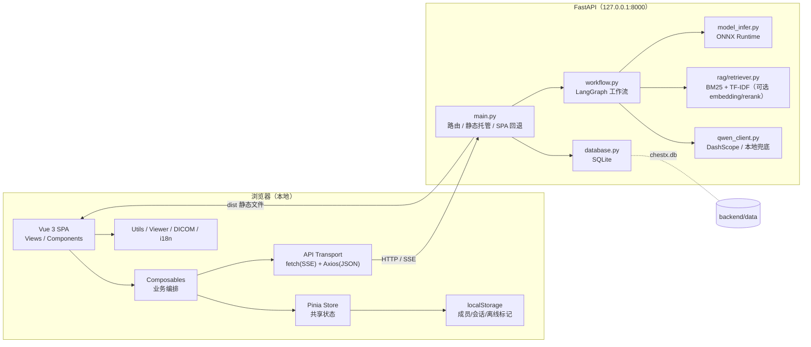
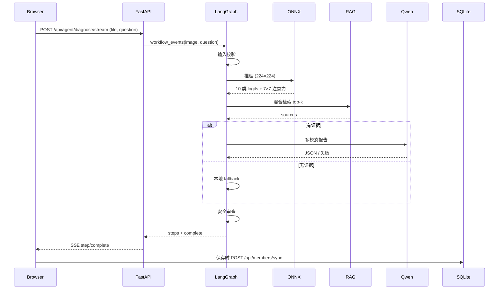

# ChestX-AI 可交付架构（v2.0.0）

> 状态：**待确认**。确认后冻结为 v2.0.0 交付架构；如需调整，按本文档的“确认点”修改后重新打 tag。
>
> 范围：`ChestX-AI-演示运行包`，Windows 单机演示优先，Linux/macOS 提供 `start.sh`。

---

## 1. 交付目标与边界

### 1.1 目标

- 一台装有 Python 3.10+ 的 Windows 电脑，解压 ZIP 后双击 `start.bat` 即可运行。
- 前端预构建为 `frontend/dist`，由 FastAPI 在 **8000 单端口** 托管，不需要目标机器安装 Node.js。
- 本地 ONNX 推理、本地 RAG、SQLite 档案；Qwen 可选，失败时自动降级。
- 交付物可审计：源码、构建产物、模型、文档、测试、Git 历史、打包脚本齐全。

### 1.2 非目标

- 不作为临床诊断系统，不处理真实患者隐私数据。
- 不做公网多租户、账号体系、HTTPS、审计合规。
- 不承诺模型精度；当前包内没有独立测试集与 model card。
- 不提供 14 类模型；模型输出固定 10 类，另外 4 类是科普扩展。

---

## 2. 交付物清单

| 交付物 | 位置 | 说明 |
|---|---|---|
| 后端源码 | `backend/` | FastAPI、ONNX、LangGraph、RAG、SQLite、Qwen |
| 前端源码 | `frontend/src/` | Vue 3、Pinia、Router、Composables、i18n |
| 前端构建 | `frontend/dist/` | 单端口托管的 SPA |
| 模型 | `backend/model.onnx` | 10 类多标签 + 7×7 注意力输出 |
| 资源 | `frontend/assets/` | 3 张演示胸片、10 张科普图、授权表 |
| 测试 | `frontend/tests/` | Node 原生测试；截图不入库 |
| 一键启动 | `一键启动.bat` / `start.bat` / `start.sh` | 双击入口、依赖检测、venv、健康检查、启动 |
| 图文说明 | `ChestX-AI-图文使用说明.docx` | 带截图的交付版说明（Word） |
| 文档 | `README.md`、`操作手册.md`、`使用说明.txt`、本文档 | 以当前代码为准 |
| 打包 | `pack_demo.py` | 生成 <200MB ZIP，排除敏感/临时文件 |
| 版本 | Git `main` + `v2.0.0` | 作者署名、可回滚 |

---

## 3. 总体架构



**关键约束**

- 前端不直接访问模型或数据库，全部经 `/api/*`。
- 后端不信任前端数据：上传校验、报告校验、证据 ID 过滤。
- 单端口：`/api/*` 是 API，其余路径回退到 `dist/index.html`。

---

## 4. 前端架构

### 4.1 分层

| 层 | 目录 | 职责 | 边界 |
|---|---|---|---|
| 路由/视图 | `src/views/` | 6 个路由入口 | 只做页面包装，避免空壳化继续扩大 |
| 页面/组件 | `src/components/` | 页面布局与展示组件 | 不直接 fetch，不写业务规则 |
| 组合式函数 | `src/composables/` | 业务编排、请求生命周期、页面状态 | 不直接操作 DOM 模板；页面卸载负责 dispose |
| 状态 | `src/stores/` | Pinia 共享状态 + 参考资料 | 不发起网络请求 |
| API | `src/api/` | 传输层：SSE、JSON、取消、错误映射 | 不读 UI 状态 |
| 工具/资源/样式 | `src/utils/`、`assets/`、`legacy.css` | 格式化、测量几何、DICOM、设计令牌 | 纯函数优先 |

> 说明：`views/` 仍是 2–7 行包装器，页面主体在 `components/*Page.vue`。这是既有实现，不在本次交付前做大规模搬迁，避免回归。

### 4.2 页面装配

```
App.vue
├─ AppGlobals          全局提示/进度
├─ FloatingAiChat      悬浮问答（SSE）
├─ AppHeader           导航 / 成员 / 语言切换
├─ RouterView
│  ├─ HomePage
│  ├─ InterpretPage    上传 / 查看器 / 分析 / 结果
│  ├─ RecordsPage      档案 / 报告详情 / 随访对比
│  ├─ KnowledgePage    模型 10 类 + 扩展 4 类
│  ├─ AcademyPage      解剖 / 征象 / 九步法 / 测验
│  └─ AboutPage        架构 / 模型输出示例 / 隐私
├─ AppFooter
└─ AppModals           报告详情 / 删除确认 / 统计 / 设置
```

### 4.3 关键子系统

| 子系统 | 主要文件 | 说明 |
|---|---|---|
| 请求生命周期 | `api/client.js` | `createApiScope()` 维护 AbortController；SSE 用 fetch，JSON 用 Axios；请求注入 `X-Request-Id` |
| 影像查看器 | `useImageViewer.js`、`utils/viewer.js`、`utils/dicom.js` | 缩放/平移/旋转/反相、亮度/对比度、长度/角度/ROI、多文件序列、未压缩 DICOM |
| 诊断链路 | `useDiagnosis.js`、`useDiagnosisResults.js`、`useInterpretPage.js` | 上传校验、SSE 步骤、概率/风险/热力图、报告展示 |
| 档案 | `useRecords.js`、`useRecordsPage.js` | localStorage 乐观更新 + SQLite 同步；演示数据标记 |
| 随访对比 | `useComparison.js`、`ComparisonPanel.vue` | 两次记录并排、概率差、风险趋势、已保存热力图 |
| 报告导出 | `useRecordDetail.js` | 模板、签名、结构化 JSON、Word `.doc`、打印/PDF |
| 国际化 | `i18n/index.js`、`i18n/en-extra.json`、`i18n/autoTranslate.js` | vue-i18n 字典 + 运行时文本/属性翻译；医学长文保留中文 |

### 4.4 数据与状态

- Pinia 只有一个 `useChestxStore`，保存 `familyMembers`、`currentMemberId`、`currentCase`、`viewer`、`records` 等共享状态。
- 页面级临时状态在 composable 闭包内，卸载时 `dispose()`。
- 健康档案双写：先 localStorage（乐观），再 `POST /api/members/sync`；失败标记 `chestx-ai-sync-pending`。

### 4.5 i18n 边界

- **界面文案**：导航、页面、表单、按钮、提示、报告导出、placeholder/aria 全部中英切换。
- **医学长文**：14 篇科普、解剖说明、九步法、测验、模型生成正文保留中文；英文模式有明确提示，需医学审校后再翻译。
- **实现方式**：vue-i18n 提供字典；运行时层负责 DOM 文本与属性；带点号的动态 key 用无点 key 显式绑定。

---

## 5. 后端架构

| 模块 | 职责 |
|---|---|
| `main.py` | FastAPI 应用、CORS、14 个业务端点、静态资源、SPA 回退 |
| `config.py` | 模型路径、上传限制、10 类疾病列表、免责声明 |
| `database.py` | SQLite 4 表、线程锁、全量同步、`is_demo`/`heatmap_data` 迁移 |
| `model_infer.py` | ONNX 懒加载、RGB/224 预处理、sigmoid、热力图叠加 |
| `workflow.py` | LangGraph：校验 → 推理 → 检索 → 报告 → 安全审查；证据不足走 fallback |
| `rag/retriever.py` | BM25 + TF-IDF + RRF 排序；DashScope embedding/rerank 可选 |
| `chat_service.py` | 意图、成员画像、Qwen 提示词、本地兜底、SSE |
| `report_service.py` | 报告字段校验、证据 ID 过滤、禁用词、`impression`、本地兜底 |
| `qwen_client.py` | `.env` 加载、兼容接口、重试/错误分类、embedding/rerank |

### 5.1 API 分组

| 分组 | 端点 |
|---|---|
| 健康 | `GET /api/health` |
| 成员 | `GET /api/members`、`POST /api/members/sync` |
| 会话 | `GET /api/conversations`、`POST /api/conversations/sync` |
| 样本 | `GET /api/samples/{id}` |
| 问答 | `POST /api/agent/chat`、`POST /api/agent/chat/stream` |
| 设置 | `GET/POST /api/settings/qwen`、`POST /api/settings/qwen/test` |
| 诊断 | `POST /api/diagnose`、`POST /api/agent/diagnose`、`POST /api/agent/diagnose/stream` |
| 前端 | `GET /`、`GET /{path}`（SPA 回退） |

### 5.2 报告契约

```json
{
  "summary": "string",
  "findings": [{"code": "", "name": "", "probability": 0.0, "explanation": ""}],
  "impression": ["string"],
  "evidence": [{"chunk_id": "", "claim": ""}],
  "limitations": ["string"],
  "suggested_actions": ["string"],
  "disclaimer": "string"
}
```

`validate_report()` 会覆盖模型 findings、过滤不存在的证据 ID、强制免责声明、拦截绝对诊断词；失败则 `build_local_fallback()`。

---

## 6. 数据架构

### 6.1 SQLite

| 表 | 用途 | 关键字段 |
|---|---|---|
| `family_members` | 成员 | id、name、age、gender、conditions、notes |
| `diagnosis_records` | 诊断记录 | probabilities_json、report_json、heatmap_data、is_demo、risk_level、image_url |
| `chat_conversations` | 会话 | member_id、messages_json、updated_at |
| `app_state` | 键值状态 | current_member_id |

- `init_db()` 自动建表；启动时做轻量迁移：`is_demo`、`heatmap_data`。
- 旧演示记录按固定 ID 标记 `is_demo=1`。
- 成员/记录同步是“全量删除 + 重插”，适合单用户演示；多端并发会覆盖。

### 6.2 诊断时序



---

## 7. 部署与运行

### 7.1 运行拓扑

```
127.0.0.1:8000
├─ /api/*            FastAPI
├─ /assets/*         frontend/dist/assets
└─ /*                dist/index.html（SPA 回退）
```

### 7.2 启动流程

```text
一键启动.bat
  → 调用 start.bat
  → 预检 model.onnx / workflow.py / dist/index.html
  → 查找 Python 3.10+（优先 .venv）
  → 检查依赖
      ├─ 已安装：直接启动
      └─ 缺失：创建 .venv → pip install -r requirements.txt
  → 检查 8000 是否已有 ChestX-AI
  → 启动 uvicorn（APP_DIR 去掉结尾反斜杠，避免吞掉 --port）
  → 轮询 /api/health
  → 打开浏览器
```

### 7.3 配置

| 变量 | 作用 | 默认 |
|---|---|---|
| `CHESTX_API_PORT` | 后端/前端端口 | 8000 |
| `DASHSCOPE_API_KEY` | Qwen Key | 读取 `backend/.env` |
| `QWEN_MODEL` | 模型 | `qwen3.8-flash` |
| `CHESTX_NO_BROWSER` | 验收/CI 不打开浏览器 | 未设置 |
| `CHESTX_NO_PAUSE` | 验收/CI 不暂停窗口 | 未设置 |

### 7.4 打包

`pack_demo.py` 生成 `ChestX-AI-跨电脑演示包-优化版.zip`：

- 包含：源码、`dist`、模型、图片、文档、`.env.example`、启动脚本。
- 排除：`.env`、`backend/data`、`__pycache__`、`.git`、`node_modules`、`frontend/tests`、备份、`.npm-cache`、杂项文件。
- 当前包体约 **35.71 MB**（<200MB）。

---

## 8. 安全与隐私边界

| 面 | 当前实现 | 风险/说明 |
|---|---|---|
| 监听 | `127.0.0.1` | 不对外网开放 |
| 鉴权 | 无 | 仅本机演示；公网部署前必须加 |
| CORS | `*` | 本机；建议后续收窄 |
| 上传 | MIME + 大小 + PIL 解码 | 未做 magic bytes/EXIF/像素上限 |
| DICOM | 未压缩 8/16 位 | 压缩格式明确拒绝 |
| Key | `backend/.env` 明文 | 不入 Git/ZIP；建议轮换 |
| 数据 | localStorage + SQLite 明文 | 未加密；不要录真实患者 |
| 报告 | 禁用词 + 免责声明 | 不等于临床安全审查 |

---

## 9. 质量门禁与验收

| 门禁 | 结果 |
|---|---|
| 前端单测 | 15/15 |
| 生产构建 | 通过（JS ~1.48MB / gzip ~519KB） |
| 启动（默认 8000） | 通过：health 200、首页 200 |
| 启动（自定义 8125） | 修复 `--app-dir` 引号转义后通过 |
| 上传 → 分析 | 通过：10 类概率、风险、报告 |
| 查看器测量 | 通过：长度标注 |
| DICOM | 通过：未压缩 DICOM 解码、分析 |
| 保存/档案/对比 | 通过 |
| JSON/Word 导出 | 通过：文件落盘、字段完整 |
| 中英切换 | 通过：界面文案；长文保留中文 |
| 移动端 390px | 通过：无横向溢出、移动菜单/保存按钮状态正确 |
| 控制台错误 | 0 |
| 打包 | 35.71MB，内容检查通过 |

**未通过/未覆盖**：干净机器自动安装依赖（当前网络下 pip 长时间无进展）；Linux `start.sh` 未实测；打印/PDF 真实对话框未自动化。

---

## 10. 关键架构决策（ADR）

| 决策 | 选择 | 理由 |
|---|---|---|
| 部署 | FastAPI 单端口托管 dist | 目标机器不需要 Node，双击即用 |
| UI 库 | 纯 Tailwind + 手写组件 | 现有视觉体系；Element Plus 已移除 |
| 状态 | 单 Pinia store | 交付前不做大拆分，降低回归 |
| 页面 | `views` 包装 + `components/*Page` | 保留既有结构，不在交付前搬迁 |
| i18n | vue-i18n + 运行时文本层 | 覆盖已有 319 条静态文案与动态/属性；不重写全部模板 |
| 模型 | 10 类 ONNX + 7×7 注意力 | 与训练输出一致；不宣称 14 类模型 |
| 科普 | 10 类模型 + 4 类扩展 | 兼顾模型覆盖与科普完整性；文案明确 10+4 |
| 存储 | SQLite + 全量同步 | 单用户演示足够；多端并发是已知限制 |
| 热力图 | 存入 `heatmap_data` | 随访对比/档案回溯需要 |
| Qwen | `.env` 持久化 + 本地兜底 | 重启可用；失败不阻断诊断 |

---

## 11. 已知风险与后续优先级

| 优先级 | 事项 | 说明 |
|---|---|---|
| P0 | 干净机器依赖安装 | 需要离线 wheelhouse 或预装 `.venv`；当前网络不可验证 |
| P1 | 医学长文英文版 | 需医学审校，不建议机器直译 |
| P1 | 模型评测/Model Card | 当前 AUC 等数字已移除，需真实测试集 |
| P2 | 全量同步改增量 | 多端并发会覆盖 |
| P2 | CORS/鉴权/上传加固 | 公网部署前必须 |
| P3 | 路由懒加载/包体拆分 | 1.48MB 单包 |
| P3 | 后端 pytest | 目前只有前端 15 项测试 |

---

## 12. 确认点

请确认以下 5 点，确认后冻结 v2.0.0：

1. **10+4 口径**：首页改为“14 类 / 模型 10 类 + 扩展 4 类科普”，模型仍称 10 类，是否接受？
2. **i18n 边界**：界面全量中英；医学长文与模型正文保留中文并提示，是否接受？
3. **依赖安装**：保持 `start.bat` 在线安装，还是改为“随包提供已装好的 `.venv`/wheelhouse”？
4. **架构冻结**：是否保留“单 Pinia store / views 包装 / 页面在 components”的现状，不在交付前重构？
5. **交付形态**：ZIP + Git 仓库（`main` + `v2.0.0`）双交付，是否接受？

---

*本文档随代码提交；确认后再打最终 tag。*
